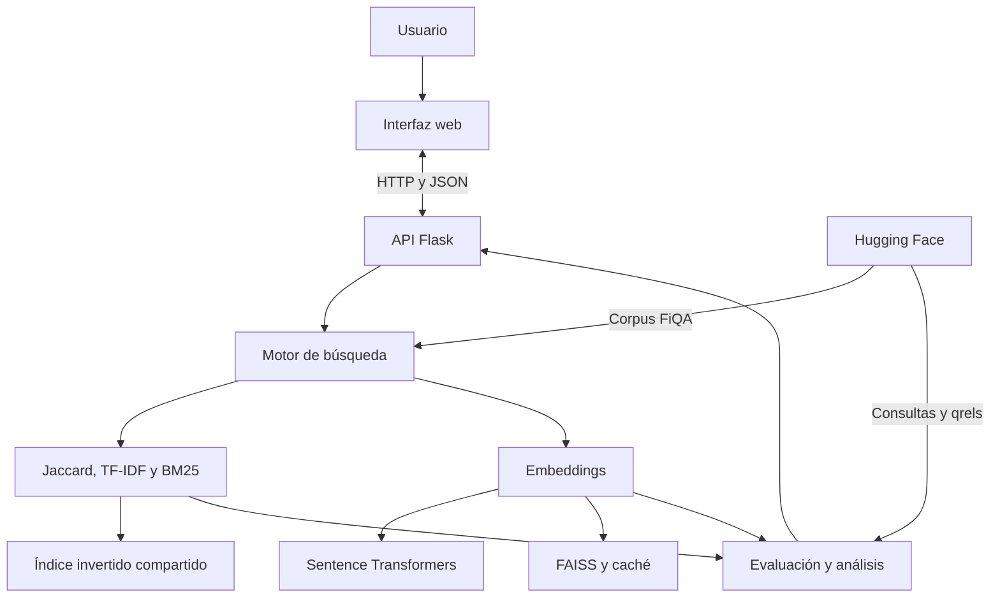

# Proyecto RIIB

Buscador y sistema de evaluación de recuperación de información sobre la colección financiera **FiQA**. Permite comparar tres modelos léxicos —Jaccard, TF-IDF y BM25— con un modelo semántico basado en embeddings.

## Funcionalidades

- Búsqueda con selección de modelo y cantidad de resultados.
- Comparación de rankings entre los cuatro modelos.
- Evaluación con consultas y juicios de relevancia de FiQA.
- Resumen global con MAP, Precision y Recall, y análisis por consulta con cortes configurables.
- Análisis por tipo y longitud de consulta, y comparación de Embeddings frente a BM25 y TF-IDF.
- Importación de corpus personalizados en JSON, JSONL y texto plano.

## Arquitectura



El frontend solicita automáticamente la carga de FiQA al abrir la aplicación si todavía no existe un corpus cargado. El servidor mantiene los índices y resultados de evaluación en memoria; al reiniciarse deben reconstruirse.

## Estructura

| Ruta | Responsabilidad |
| --- | --- |
| `server.py` | API Flask, importación, modelos léxicos y evaluación. |
| `dense_retrieval.py` | Modelo semántico, vectores, índice FAISS y caché. |
| `evaluation_analysis.py` | Análisis por grupos y comparaciones semánticas. |
| `front/` | Interfaz, estilos y recursos. |
| `tests/` | Pruebas de búsqueda, evaluación, embeddings y frontend. |
| `requirements.txt` | Dependencias Python para ejecución local. |
| `Dockerfile`, `gunicorn.conf.py`, `railway.json` | Configuración de despliegue. |
| `docs/railway.md` | Guía complementaria para Railway. |

## Requisitos

- Python compatible con las dependencias; el Dockerfile utiliza Python 3.12.
- Conexión a internet para la primera descarga de FiQA, el modelo y, si es necesario, las stopwords de NLTK.
- Espacio en disco y memoria suficientes para el corpus, el modelo y los índices.
- Node.js para ejecutar la prueba del frontend; no es necesario para iniciar Flask.

La primera generación de embeddings puede tardar y requerir bastante memoria.

## Instalación y ejecución local

En PowerShell, desde la carpeta que contiene `server.py`:

```powershell
python -m venv .venv
.\.venv\Scripts\Activate.ps1
python -m pip install --upgrade pip
python -m pip install -r requirements.txt
python server.py
```

Abrir **http://127.0.0.1:5000**. Mantener la terminal abierta mientras se utiliza la aplicación. El servidor de Flask ejecutado así está pensado para desarrollo local.

Si PowerShell indica que falta Flask, activar el entorno y ejecutar:

```powershell
python -m pip install -r requirements.txt
```

Si la ejecución de scripts está deshabilitada, puede usarse el intérprete del entorno directamente:

```powershell
.\.venv\Scripts\python.exe -m pip install -r requirements.txt
.\.venv\Scripts\python.exe server.py
```

En Linux o macOS:

```bash
python3 -m venv .venv
source .venv/bin/activate
python -m pip install -r requirements.txt
python server.py
```

## Uso

1. Abrir la aplicación y esperar a que se cargue el corpus.
2. Escribir una consulta, seleccionar Jaccard, TF-IDF, BM25 o Embeddings y escoger el número de resultados.
3. Usar **Comparar modelos** para ver sus rankings.
4. Abrir **Métricas** para consultar los resultados globales y por consulta.
5. Introducir de uno a tres cortes enteros, positivos y distintos, por ejemplo `5, 10, 20`.

La primera vez que se selecciona Embeddings, el índice semántico se carga o genera en segundo plano. La evaluación semántica también se ejecuta en segundo plano y puede tardar más que la de los modelos léxicos.

## Corpus y preprocesamiento

El corpus predeterminado es `BeIR/fiqa`; la evaluación utiliza sus consultas y la partición `test` de `BeIR/fiqa-qrels`. Los qrels relacionan una consulta con documentos y sus grados de relevancia. El código considera relevante un grado mayor o igual a 1; un documento sin juicio se trata como no relevante para el cálculo.

Los modelos léxicos convierten el campo `text` a minúsculas, extraen términos y números mediante una expresión regular y eliminan stopwords inglesas. No se aplica stemming ni lematización. Embeddings codifica el título y el texto unidos.

Un único índice invertido almacena término → documento → frecuencia. Jaccard, TF-IDF y BM25 comparten esa estructura.

## Modelos

- **Jaccard:** compara los conjuntos de términos distintos de la consulta y el documento: intersección dividida para unión.
- **TF-IDF:** utiliza frecuencias, IDF suavizado `ln((N+1)/(df+1))+1` y similitud coseno.
- **BM25:** pondera coincidencias usando IDF, saturación de frecuencia y longitud del documento; valores predeterminados `k1=1.2` y `b=0.75`.
- **Embeddings:** utiliza `sentence-transformers/all-MiniLM-L6-v2` para obtener vectores de 384 dimensiones. Tras normalizarlos, FAISS `IndexFlatIP` los compara mediante producto interno, equivalente al coseno para vectores unitarios.

Los modelos léxicos devuelven coincidencias de términos. En evaluación, Embeddings solicita el ranking completo del índice; por ello la Precision general entre modelos debe interpretarse junto con Precision@k y las demás métricas.

### Documentos vacíos

La importación conserva los documentos vacíos. Los modelos léxicos no los recuperan si no contienen términos indexados. El índice semántico de esta versión también puede codificar texto vacío, por lo que esos documentos pueden aparecer en Embeddings como «Documento sin texto». Los documentos sin términos también cuentan en las estadísticas de la colección.

## Evaluación

Para cada consulta se compara el ranking con los qrels correspondientes:

- **Precision:** relevantes recuperados / documentos recuperados.
- **Recall:** relevantes recuperados / relevantes conocidos.
- **Precision@k:** relevantes entre los primeros k / k, incluso si se recuperaron menos de k documentos.
- **Recall@k:** relevantes entre los primeros k / relevantes conocidos.
- **AP:** promedio de las precisiones en las posiciones relevantes, dividido entre el total de relevantes conocidos.
- **MAP:** promedio de AP entre consultas.
- **NDCG@k:** compara la ganancia descontada del ranking con la de un orden ideal según los grados de relevancia.

Precision y Recall globales son promedios por consulta. El resumen mostrado presenta MAP, Precision y Recall; las métricas por corte se consultan por consulta. El backend también calcula promedios por corte.

Los qrels pueden estar incompletos: tratar un documento sin juicio como no relevante es una convención de esta implementación, no una prueba de que no sea útil. Un corpus personalizado no recibe automáticamente qrels de FiQA.

La comparación rápida mediante `/api/compare` utiliza como referencia los documentos del top-k de BM25 y mide solapamiento con ellos. **Es distinta de la evaluación contra qrels** en la vista de métricas.

## Análisis por consultas

Las consultas se clasifican mediante reglas aproximadas en comparación, definición, procedimiento, explicación u otras. También se agrupan por longitud tokenizada, usando cortes calculados a partir de la distribución; los empates de longitud pueden producir grupos desiguales.

El análisis informa MAP por grupo y modelos con mejor puntuación. La comparación semántica calcula, para cada consulta, la diferencia entre el AP de Embeddings y el de BM25 o TF-IDF, y muestra ejemplos de mejoras y empeoramientos. Los resultados son descriptivos y dependen de los qrels y del tamaño de cada grupo.

## Importar un corpus propio

En la vista **Métricas**, seleccionar un archivo y pulsar **Importar corpus**. Los archivos se leen como UTF-8:

- `.json`: lista de documentos o un objeto con la clave `documents`.
- `.jsonl`: un objeto JSON por línea.
- `.txt`: cada línea no vacía se considera un documento.

Ejemplo JSON:

```json
[
  {"_id": "d1", "title": "Préstamos", "text": "Un préstamo tiene intereses."},
  {"_id": "d2", "title": "Ahorro", "text": "Un fondo permite ahorrar."}
]
```

También se aceptan `id` para el identificador y `content` para el texto. Si no hay ID, se utiliza la posición. Utilizar IDs únicos y textos con contenido. Cambiar de corpus invalida las evaluaciones e índices anteriores.

## Preparación y caché de embeddings

Para preparar el índice antes de iniciar el servidor:

```powershell
python dense_retrieval.py --build
```

Para una prueba pequeña:

```powershell
python dense_retrieval.py --build --limit 200
```

La caché se guarda en `.cache/dense/` e incluye vectores, IDs y metadatos. Su huella depende del modelo y del contenido y orden del corpus. Una caché creada con `--limit` solo sirve para ese subconjunto. Para regenerarla explícitamente se puede añadir `--force`.

El modelo y los datos de Hugging Face también utilizan sus propias cachés. En un contenedor sin almacenamiento persistente, las cachés locales pueden perderse al recrearlo.

Variables útiles:

| Variable | Uso |
| --- | --- |
| `DENSE_BATCH_SIZE` | Tamaño del lote interno para codificar; valores menores pueden reducir picos de memoria a costa de velocidad. |
| `DENSE_BUILD_IF_MISSING` | Controla si se generan embeddings cuando falta la caché. |
| `HF_HOME` | Directorio de caché de Hugging Face. |
| `PORT` | Puerto utilizado por Gunicorn; Railway lo asigna. |

## API

| Método | Ruta | Uso |
| --- | --- | --- |
| GET | `/healthz` | Comprueba que el servidor responde; no garantiza que el corpus esté listo. |
| GET | `/api/corpus/status` | Estado del corpus y del índice semántico. |
| POST | `/api/corpus/import` | Importa desde Hugging Face o mediante archivo. |
| POST | `/api/search` | Ejecuta una búsqueda. |
| POST | `/api/compare` | Compara rankings y solapamiento con BM25. |
| GET | `/api/metrics?cuts=5,10,20` | Métricas, estado de evaluación y análisis. |

Ejemplo de búsqueda en PowerShell:

```powershell
$body = @{ q = "bank loan"; model = "bm25"; k = 5 } | ConvertTo-Json
Invoke-RestMethod -Uri "http://127.0.0.1:5000/api/search" -Method Post -ContentType "application/json" -Body $body
```

Los valores de `model` son `jaccard`, `tfidf`, `bm25` y `dense`. La API limita `k` entre 1 y 100.

## Pruebas

Desde la raíz del proyecto:

```powershell
python -m unittest discover -s tests -v
node tests/test_frontend.cjs
```

Algunas pruebas de Embeddings dependen de FAISS, sentence-transformers y de que el modelo esté disponible; pueden requerir descarga o ser omitidas cuando faltan dependencias.

## Docker y Railway

Construcción y ejecución local con Docker:

```bash
docker build -t proyecto-riib .
docker run --rm -p 5000:5000 proyecto-riib
```

Abrir `http://localhost:5000`. El Dockerfile instala PyTorch para CPU y utiliza Gunicorn. Para Railway, conectar el repositorio, usar la raíz y el Dockerfile, y dejar vacío el comando de inicio personalizado para utilizar el CMD de la imagen. La guía complementaria está en [docs/railway.md](docs/railway.md).

El servicio utiliza un worker para compartir los índices en memoria. El consumo, los límites y los costos dependen del proveedor y del plan vigente: verificar el panel antes de desplegar. Un `/healthz` correcto no implica que el corpus o Embeddings hayan terminado de cargar.

## Solución de problemas

- **Corpus no importado:** revisar `/api/corpus/status`, los registros y la conexión con Hugging Face. Al reiniciarse el proceso, el corpus en memoria debe cargarse nuevamente.
- **Embeddings tarda en cargar:** la primera ejecución descarga el modelo y genera vectores. Consultar el progreso de `dense` en el estado del corpus.
- **Reinicio durante Embeddings:** revisar el consumo de RAM y los registros del servicio. Reducir `DENSE_BATCH_SIZE` puede disminuir el pico, aunque no garantiza que se ajuste al límite.
- **Documento sin texto:** esta versión puede indexar documentos vacíos en Embeddings.
- **Métricas no disponibles para un archivo propio:** los qrels de FiQA no se aplican automáticamente a corpus personalizados.
- **Error al instalar una dependencia:** comprobar la versión de Python y la compatibilidad de los paquetes con el sistema operativo.
